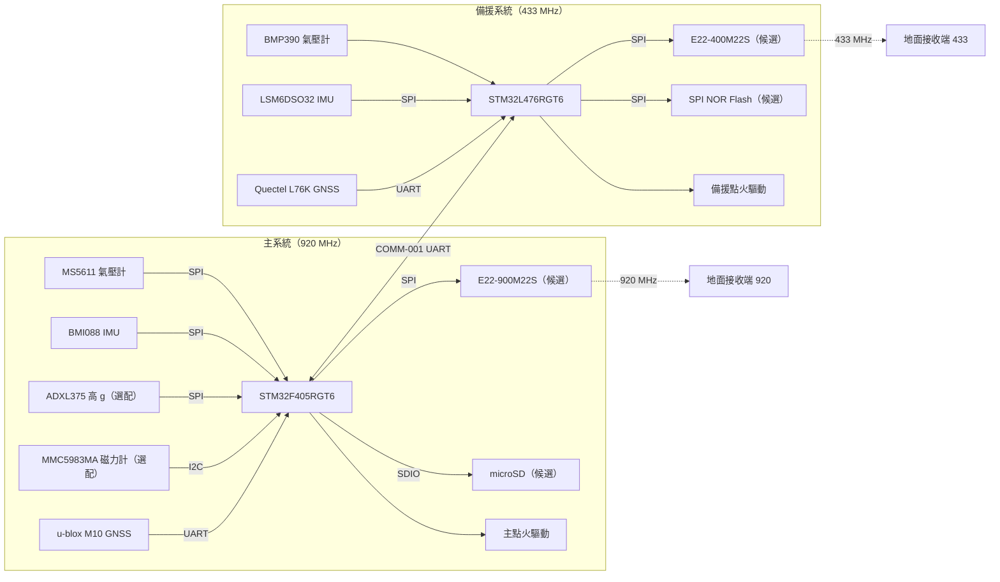

# 系統架構草案

狀態：草案／尚未定案。最後更新：2026-11-14。

本文件是航電架構、設計與選型的總覽入口，只放目前的結論與連結。理由寫在 [設計決策](decisions.md)，元件細節寫在 [元件選型總表](component_selection.md)，介面細節寫在 [介面規格](interfaces.md)，機構細節寫在 [CAD 說明](../mechanical/cad/README.md)。

目前只有 DEC-001 由使用者決定（待 PR 審查與團隊確認）；DEC-002、DEC-003 與本文件其餘內容都還是提案或概念，尚未經團隊審查。

## 現況

| 項目 | 現況 | 決策來源 |
| --- | --- | --- |
| 主航電職責與硬體 | 提案中：MCU STM32F405RGT6，負責開傘判斷、主遙測與資料記錄 | [DEC-003](decisions.md) |
| 備援方式與獨立性 | 主系統用 920 MHz、備援系統用 433 MHz，各自持有 MCU、感測器、無線電與電池；主備以序列線互報摘要。備援 MCU 提案為 STM32L476RGT6 | [DEC-001](decisions.md)、[DEC-003](decisions.md) |
| 感測與資料流 | 感測器提案中：主系統 MS5611、BMI088、ADXL375（選配）、MMC5983MA（選配）、u-blox M10；備援 BMP390、LSM6DSO32、Quectel L76K。資料流待確認 | [DEC-002](decisions.md) |
| 板間通訊 | 候選：Samtec SFM／TFM 1.27 mm 雙排板對板堆疊接頭，插合高度 11.81 mm，兩臂各一組，主系統與備援各用一臂；完整料號與腳位待確認 | [元件選型總表](component_selection.md) |
| 地面站 | 兩台接收端分別接收 920 MHz 與 433 MHz；硬體與軟體待確認 | [DEC-001](decisions.md) |
| 電源與機構接口 | 機構為概念模型 avbay v0.10；4 顆 18650，組態（2S 或 1S2P）待確認 | [MECH-001](interfaces.md)、[CAD 說明](../mechanical/cad/README.md) |
| 記錄與測試方式 | 待確認 | 待建立 |

## 系統組成

| 系統 | 職責 | 遙測 | 狀態 |
| --- | --- | --- | --- |
| 主系統 | 飛行狀態判斷、主開傘、主遙測、完整資料記錄 | 920 MHz LoRa（RF-001） | 提案中 |
| 備援系統 | 獨立判斷頂點與開傘、回報位置、記錄 | 433 MHz LoRa（RF-002） | 提案中 |
| 公版 GPS 追蹤器 | 大會規定的定位回報，與航電電氣上無連接 | Meshtastic TW，約 920.125 MHz | 大會提供 |
| 地面站 | 兩台接收端分別接收主備遙測 | 920 MHz、433 MHz | 待確認 |

主備的設計原則：

- 單點故障不得讓主備同時失效：各自持有 MCU、感測器、無線電與電池。
- 主備使用不同廠牌或不同系列的晶片，降低同一缺陷同時影響兩邊的機率。
- 主備之間只有一條有隔離或限流保護的序列線（COMM-001），一方短路、當機或斷電不得影響另一方。

## 系統方塊圖

標示「候選」的元件尚未寫成決策。點火通道數量、電源路徑與板間連接尚未決定，圖中未畫。

## 機構配置

概念模型 avbay v0.10 裝在鼻錐肩部內，由下往上為：

| 區段 | 內容 |
| --- | --- |
| 艙壁板 | 直徑 130，承載整組航電艙 |
| 電路板堆疊 | 5 片直徑 110 的馬蹄形 PCB，套在 4 支 M3 螺桿上，層距 13.41（板間 11.81，等於 SFM／TFM 插合高度） |
| 中央脊柱電池槽 | 位於 PCB 開槽內，4 顆直立 18650，兩顆一組沿 X 前後排列，側蓋以螺絲固定 |
| 設備艙 | 板堆疊上方，放公版 GPS 追蹤器與自製 GPS 板；−Y 面支架裝 920 MHz 天線 |
| 頂蓋 | 裝 433 MHz 天線、追蹤器天線與 GNSS 貼片 |

PCB 預定用途（由底部往尖端，尚未寫入決策紀錄）：

| 層 | 用途 | 主要內容 |
| --- | --- | --- |
| 1 | 備援 | STM32L476、備援感測器、433 MHz 無線電、記錄 |
| 2 | 電源 | 電池保護、升降壓、分流、電壓電流監測、開關 |
| 3 | 主系統 | STM32F405、主感測器、SD 卡、點火驅動 |
| 4 | 預留 | — |
| 5 | 通訊 | 920 MHz 無線電、天線介面 |

電池下層一對預定給備援，上層一對給主系統。尺寸、孔位與間隙見 [CAD 說明](../mechanical/cad/README.md) 與 interfaces.md 的 MECH-001。

## 待確認

- 最大加速度模擬：決定是否加 ADXL375，以及備援量程是否足夠。
- 板間連接：SFM／TFM 完整料號與鎖扣選項、樣品實測插合高度、腳位表、電源與訊號分配、電壓準位。
- 電源架構：電池組態、各層電壓軌、功耗預算與續航驗算。
- 點火：通道數量、驅動方式、導通檢測與安全開關。
- 無線電模組與資料記錄方式。
- 433 MHz 在台灣的使用條件與比賽規則。
- 資料流：取樣率、狀態機、記錄格式與遙測封包。

確定方向後，重大決策先寫入 decisions.md，再更新本文件的結論；介面細節寫在 interfaces.md。有實作後再拆分更詳細文件。
