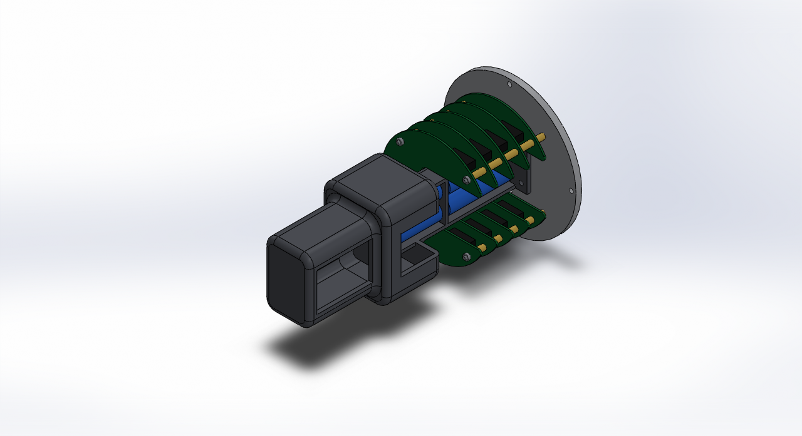
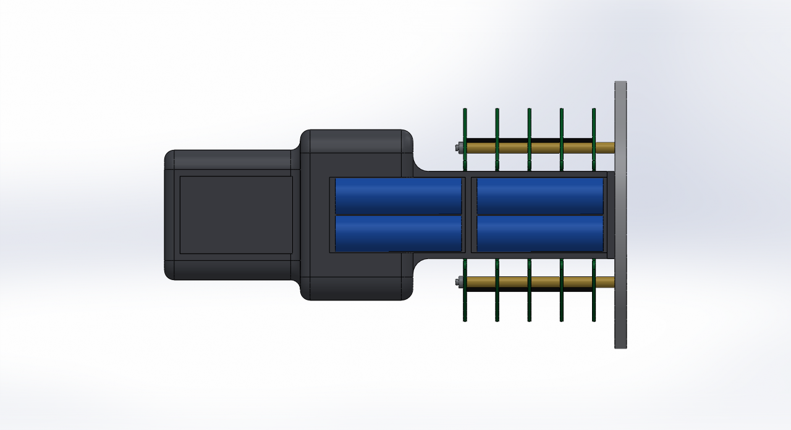
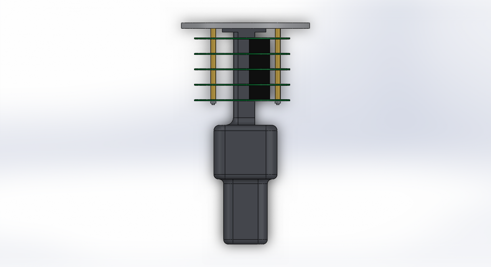

# CAD 來源

狀態：概念模型 avbay v0.4，尚未經團隊審查，尺寸未定案。

CAD 工具：SOLIDWORKS 2018 SP3。較新版本可開啟，但存檔後舊版無法再開，升級前先討論。

## 構型

- 艙壁板位於鼻錐底部，承載整組航電艙。
- 馬蹄形電路板套在四支 M3 貫穿螺桿上，層與層之間用間隔柱隔開，頂端以螺帽壓緊。電路板不鎖在列印件上。
- 3D 列印的中央脊柱立在艙壁板上，位於電路板的開槽內。下段是朝 +X 開口的電池槽，放四顆 18650，從開口側取放。
- 板堆疊上方，脊柱以圓角過渡擴成兩段中空的設備艙，供天線、GPS 等模組安裝在外側平面上。

版本沿革：v0.1（四支周邊支柱加直立托架）、v0.2（脊柱等截面直通到頂）、v0.3（電路板鎖在脊柱伸出的薄承板上、上半部以 45° 斜面外擴）皆未被採用，檔案已移除，未曾提交。v0.3 的薄承板無法實際鎖固，外形比例也不協調，因此改為 v0.4。

## 組立入口

開啟 `avbay_v0_4_assembly.SLDASM`。座標原點在艙壁板底面中心（即鼻錐底面），+Z 指向鼻錐尖端，+X 是脊柱與電路板的開口側。模型只包含航電艙，不含鼻錐外殼。







## 檔案

| 檔案 | 內容 | 站位 z（mm） |
| --- | --- | --- |
| `avbay_v0_4_bulkhead.SLDPRT` | 艙壁板，直徑 138、厚 6 | 0 至 6 |
| `avbay_v0_4_spine.SLDPRT` | 中央脊柱：底座、電池槽、兩片電池隔板、兩段設備艙 | 6 至 238 |
| `avbay_v0_4_pcb_outline.SLDPRT` | 馬蹄形 PCB 外形，直徑 110、厚 1.6，共用 5 次 | 16、32.6、49.2、65.8、82.4 起 |
| `avbay_v0_4_rod_m3.SLDPRT` | M3 螺桿，長 88，4 支 | 0 至 88 |
| `avbay_v0_4_spacer_m3_10.SLDPRT` | 間隔柱，長 10，4 支 | 6 至 16 |
| `avbay_v0_4_spacer_m3_15.SLDPRT` | 間隔柱，長 15，16 支 | 各層板之間 |
| `avbay_v0_4_nut_m3.SLDPRT` | 螺帽佔位，4 個 | 84 至 86.4 |
| `avbay_v0_4_stack_connector.SLDPRT` | 板對板接頭佔位，22 × 7 × 15，8 個 | 各層板之間 |
| `avbay_v0_4_cell_18650.SLDPRT` | 18650 電池佔位，直徑 18.5、長 65，4 顆 | 12 至 77、85 至 150 |
| `avbay_v0_4_assembly.SLDASM` | 組合件，47 個元件，全部固定、未加結合條件 | — |
| `build_avbay.py` | 產生以上檔案與三張預覽圖的參數化腳本 | — |

PCB 由底部往尖端的預定用途：1 備援、2 電源、3 主系統、4 預留、5 通訊。電池下層一對預定給備援，上層一對給主系統。此分配尚未寫入決策紀錄，對應的板版號尚未建立。

## 關鍵尺寸

電路板與固定：

- PCB 開槽：寬 47（Y 方向 ±23.5），自 x = −14 開到 +X 板邊，槽底兩角 R6，兩個馬蹄尖端 R3；開槽後板面積約剩 68%。
- 螺桿孔：4 個 M3 孔（孔徑 3.2）位於節圓 98，角度 45°、135°、225°、315°。
- 層距 16.6（15 的間隔柱加板厚 1.6）。
- 板對板接頭佔位中心在 (15, ±36)，僅表示預留空間，實際型號與位置未定。

脊柱：

- 電池槽段（z 6 至 110 外露，槽壁在艙內延續到 z 156）：X 方向 −13 至 +10、Y 方向 ±22.5，壁厚 3，背面兩角 R5；槽內寬 39、深 20。
- 底座：47 × 45、厚 4，以 4 顆 M4 鎖在艙壁板，孔位 (−19, ±15) 與 (16, ±15)。
- 設備艙一（z 110 至 168）：68 × 88，垂直角 R12，壁厚 4，底面距最上層板頂面 26。+X 面有電池取放開口（寬 39，z 114 至 153）。
- 設備艙二（z 168 至 238）：47 × 67，垂直角 R10，壁厚 4。+X 面有檢修開窗（寬 40，z 172 至 230）。兩艙內部相通。
- 圓角過渡：電池槽段接設備艙一底面 R8；設備艙一底緣 R6；設備艙一頂緣、設備艙二根部與頂緣各 R5。

艙壁板開孔：4 個 M3 螺桿孔、4 個 M4 固定孔（節圓 128、0° 起）、4 個 M4 脊柱底座孔、2 個 M6 U 型螺栓孔位於 (0, ±30)、1 個直徑 10 的走線孔位於 (−40, 0)。

## 重新產生

需要 Windows、已啟動且沒有開啟任何文件的 SOLIDWORKS、Python 3.10 以上與 pywin32。

```bash
python mechanical/cad/build_avbay.py
```

尺寸集中在腳本開頭的 PARAMS。腳本會覆寫本目錄中同名的 avbay_v0_4 檔案；手動修改過的模型請另存新版號。

## 已知限制與驗證狀態

- 鼻錐外殼不在模型內。腳本仍保留鼻錐內輪廓 `nose_profile`，只用來計算徑向間隙；該輪廓是從一張 304×198 像素的示意圖換算，以底部內徑 140 為基準，誤差約 5%，取得實際外形後必須更新並重新檢查。
- 沒有外部引用，沒有第三方模型。
- 已執行：SOLIDWORKS 干涉檢查 0 處（重合面不計，只涵蓋航電艙內部零件）；航電艙對鼻錐內壁的徑向間隙由腳本依 `nose_profile` 計算，為艙壁板 1.0、最上層板 11.9、設備艙一頂角 5.7、設備艙二頂角 5.9，未經 CAD 幾何驗證。兩個設備艙的間隙與鼻錐輪廓的量測誤差同一量級，取得實際鼻錐外形前不能視為確定可裝入。
- 已讀回：脊柱為單一實體，體積約 181 cm³（以實心 PETG 估算約 230 g，實際重量取決於列印填充率）。
- 尚未執行：強度、振動、熱、列印與製造可行性、實體試裝。
- 尚未建模：設備艙上的模組安裝孔位與走線孔、電池接點與固定方式、電池槽蓋、主備電池之間的防火隔離、鼻錐內的列印固定環、各模組本體、天線、螺桿在艙壁板側的固定方式、線束、解鎖開關與對外開孔。
- 設備艙一的底面是懸空面，兩個設備艙的頂板也是封閉的；列印方向、是否需要支撐材或拆件尚未評估。
- 螺桿頂端的螺帽在 z 84 至 86.4，設備艙一底面在 z 110，其間約 24 的空間供扳手與走線使用，實際是否足夠需要試裝確認。
- 設備艙一的底面是由 z 96 上移到 z 110，頂面維持 z 168 不動，因此艙高由 72 減為 58，對鼻錐的間隙不變。
- 電池只是圓柱佔位，顆數與串並聯方式未定案。下層電池位於板堆疊的開槽內，取放是否順手需要試裝確認。

需要交換 STEP／STL 時，再建立 exports/ 並記錄來源版本。關鍵尺寸與裝配介面集中到 docs/interfaces.md。模型存在不代表完成干涉、強度或製造驗證。
