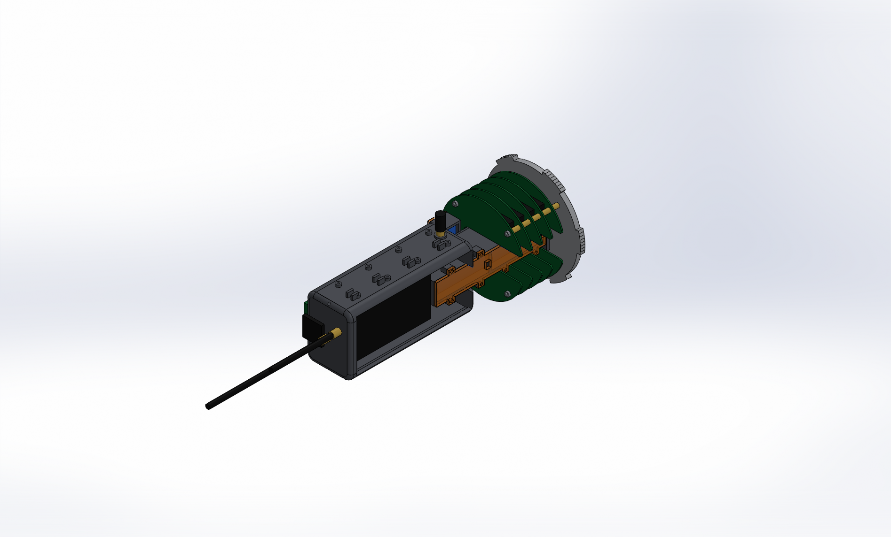
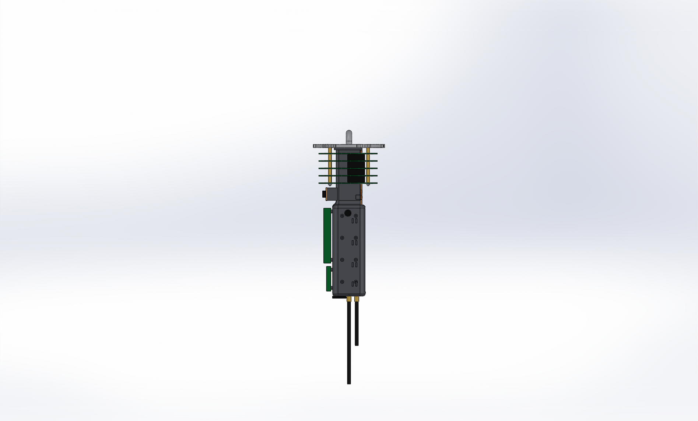
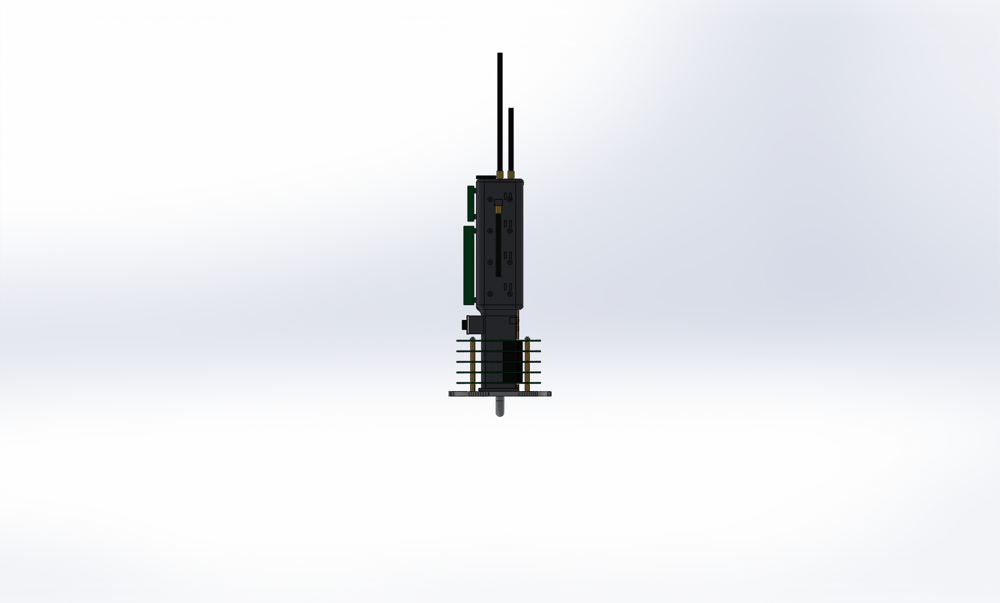
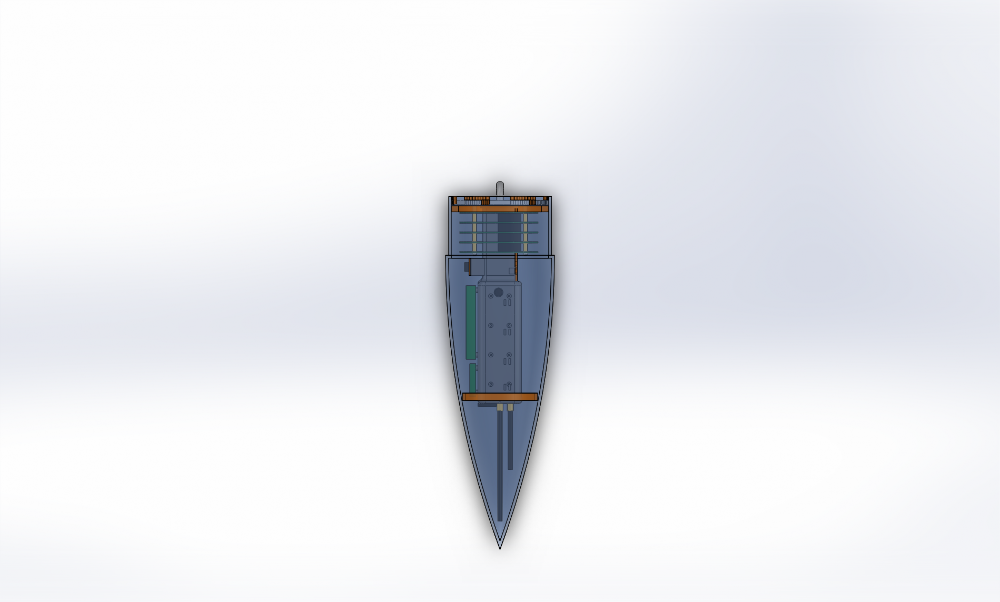
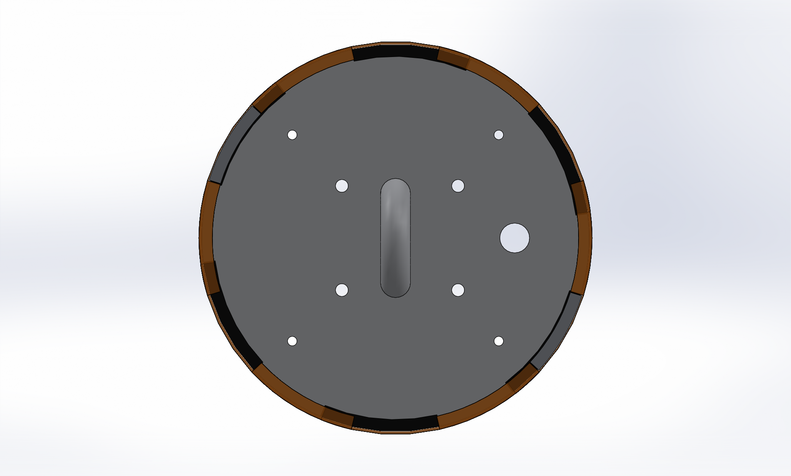
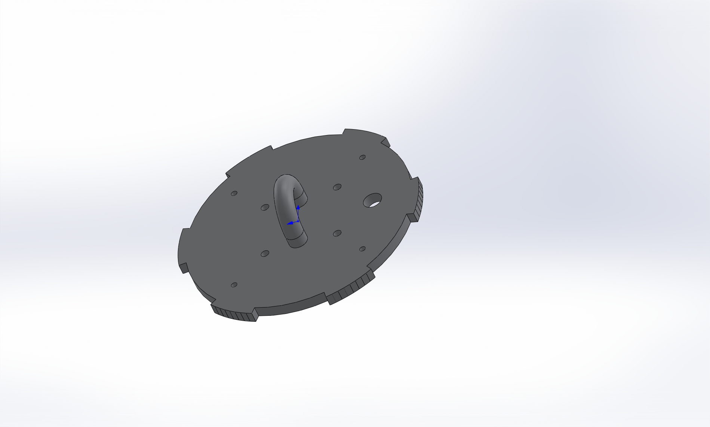

# CAD 來源

狀態：概念模型 avbay v0.12，尚未經團隊審查，尺寸未定案。

> 2026-11-27 起，商用高度計已依 [DEC-004](../../docs/decisions.md) 取消，PCB 改為四層（DEC-006）。v0.12 模型仍含高度計、高度計電池盒、擋板與開關，以及 5 片 PCB，要在下一版 CAD 移除與更新；本文件以下描述的仍是 v0.12 模型本身。

CAD 工具：SOLIDWORKS 2018 SP3。較新版本可開啟，但存檔後舊版無法再開，升級前先討論。

## 構型

- 鋁製艙壁板位於鼻錐肩部內，承載整組航電艙，並以旋轉卡扣鎖在鼻錐上：艙壁板邊緣有 6 個凸耳，鼻錐肩部內壁印有 6 個卡榫，放入後轉約 25.2° 鎖定。
- 馬蹄形電路板套在四支 M3 貫穿螺桿上，層與層之間用間隔柱隔開，頂端以螺帽壓緊。電路板不鎖在列印件上。
- 3D 列印的中央脊柱立在艙壁板上，位於電路板的開槽內。下段是朝 +X 開口的電池槽，放四顆直立的 18650：兩顆一組、沿 X 前後排列，電池周圍留約 1 至 1.75 mm 供緩衝套使用。每組點焊成一體，整組從開口側沿 X 抽出，開口以螺絲鎖的側蓋封住。
- 板堆疊上方，脊柱以圓角過渡擴成一段等截面的中空設備艙。台灣盃公版 GPS 追蹤器（Rocket Beacon）直立放在艙內，由 +X 面的開口取放。
- 設備艙的 −X、+Y、−Y 三個外側面是安裝面：有 M3 自攻螺絲凸台（小模組用）與束線柱（走線用）。−X 面由下往上鎖主傘用的商用高度計與自製 GPS 板。
- 商用高度計的獨立電池放在脊柱背面（−X 側）的列印電池盒裡，位於板堆疊與設備艙之間；電池盒朝 −X 開口，以擋板封住，擋板上裝高度計的電源開關。
- 設備艙頂端是可拆的列印頂蓋，以兩顆螺絲鎖在 ±Y 牆頂；433 MHz 與追蹤器兩支軟質天線、自製 GPS 貼片裝在頂蓋上。923 MHz 天線裝在 −Y 面的列印支架上，往下垂掛。

這些做法參考 USCRPL HAMSTER 實物：方柱外側面裝模組、獨立頂蓋裝天線、軟質天線、線材沿柱身用夾子固定。

版本沿革：v0.1 至 v0.6 皆未被採用，檔案已移除（v0.4 曾提交，見 git 歷史）。v0.7、v0.8 的檔案已被取代（見 git 歷史）；v0.9 的檔案未曾提交，已刪除，需要時把 `build_avbay.py` 的參數改回即可重建。v0.7 在 v0.6 的單段設備艙上加入外側安裝面、束線柱、可拆頂蓋，並把硬鋼絲天線改為軟質天線。v0.8 把電池槽每邊放大 1 mm 供緩衝套使用，並加上以 8 顆 M3 螺絲固定的電池槽側蓋；PCB 開槽因此加寬 2 mm。v0.9 把每組兩顆電池從沿 Y 並排改成沿 X 前後排列（仍然直立），電池槽與 PCB 開槽因此變窄；923 MHz 天線從頂蓋移到設備艙 −Y 面的支架上，往下垂掛。v0.10 依層間接頭 Samtec SFM／TFM 的插合高度，把板間距從 15 改為 11.81（層距 13.41），接頭佔位改為主系統臂 2×20、備援臂 2×10，並把下方兩排側蓋凸耳移到新的板間位置。v0.11 加入主傘用的商用高度計：高度計直立鎖在設備艙 −X 面，自製 GPS 板上移 32；脊柱背面加一個高度計電池盒、擋板與開關佔位。v0.12 把公版追蹤器改為大會簡報的尺寸（36 × 57 × 106）；艙壁板改為鋁製、帶 6 個凸耳的旋轉卡扣外形，取消原本鎖進鼻錐的 4 個 M4 孔；新增鼻錐肩部內的座環、卡榫、止擋、防鬆鍵、墊片與上段定心環，航電艙因此比鼻錐開口端面高 5.5。

## 組立入口

- 航電艙本體：`avbay_v0_12_assembly.SLDASM`。座標原點在艙壁板底面中心；裝入鼻錐後，艙壁板底面在鼻錐開口端面上方 5.5，本文件的站位 z 都是航電艙自己的座標，換算成鼻錐站位要加 5.5。+Z 指向鼻錐尖端，+X 是脊柱與電路板的開口側。
- 裝入鼻錐的檢查：`fitcheck_avbay_v0_12_assembly_in_NOSE_v1.SLDASM`，由 `fitcheck_nose.py` 產生，鼻錐設為半透明。









## 檔案

| 檔案 | 內容 | 站位 z（mm） |
| --- | --- | --- |
| `NOSE_v1.SLDPRT` | 鼻錐（團隊提供）：總長 480，錐體外徑 148、壁厚 4，肩部外徑 140、內徑 132、長 80 | 建模方向為 +X，尖端在 x = 0 |
| `avbay_v0_12_bulkhead.SLDPRT` | 鋁製艙壁板，本體直徑 122、厚 6；邊緣 6 個凸耳伸到半徑 65，每個寬 24°；底面有一體的吊環（桿徑 10、彎曲中心半徑 15、內側開口寬 20），用來綁繫鼻錐的繩子 | −26 至 6 |
| `avbay_v0_12_spine.SLDPRT` | 中央脊柱：底座、電池槽、兩片電池隔板、側蓋螺絲凸耳、設備艙（無頂）、凸台、束線柱、923 MHz 天線支架 | 6 至 272 |
| `avbay_v0_12_cap.SLDPRT` | 設備艙頂蓋：3 高的內嵌唇加 4 厚的蓋板，含兩個天線孔與螺絲孔 | 269 至 276 |
| `avbay_v0_12_pcb_outline.SLDPRT` | 馬蹄形 PCB 外形，直徑 110、厚 1.6，共用 5 次 | 16、29.41、42.82、56.23、69.64 起 |
| `avbay_v0_12_rod_m3.SLDPRT` | M3 螺桿，長 75.2，4 支 | 0 至 75.2 |
| `avbay_v0_12_spacer_m3_10.SLDPRT` | 間隔柱，長 10，4 支 | 6 至 16 |
| `avbay_v0_12_spacer_m3_stack.SLDPRT` | 板間間隔柱，長 11.81（等於接頭插合高度，需訂做），16 支 | 各層板之間 |
| `avbay_v0_12_nut_m3.SLDPRT` | 螺帽佔位，4 個 | 71.2 至 73.6 |
| `avbay_v0_12_stack_connector_2x20.SLDPRT` | 主系統臂板對板接頭佔位（Samtec SFM／TFM 2×20），31 × 6 × 11.81（本體尺寸為估計值），4 個，位於 +Y 臂 | 各層板之間 |
| `avbay_v0_12_stack_connector_2x10.SLDPRT` | 備援臂板對板接頭佔位（Samtec SFM／TFM 2×10），18.3 × 6 × 11.81（本體尺寸為估計值），4 個，位於 −Y 臂 | 各層板之間 |
| `avbay_v0_12_cell_18650.SLDPRT` | 18650 電池佔位，直徑 18.5、長 65，4 顆，中心在 x = ±10、y = 0 | 12 至 77、85 至 150 |
| `avbay_v0_12_cell_cover.SLDPRT` | 電池槽側蓋，寬 28、厚 3，兩側各 4 個耳片與螺絲孔，含兩處電池線開口；以組合件座標建模 | 10.5 至 155.5 |
| `avbay_v0_12_tracker.SLDPRT` | 公版 GPS 追蹤器佔位，36 × 57 × 106（依大會簡報的 PCB 圖） | 158 至 264 |
| `avbay_v0_12_gps_board.SLDPRT` | 自製 GPS 板佔位，8 × 30 × 45，立於 −X 面凸台上 | 222 至 267 |
| `avbay_v0_12_altimeter.SLDPRT` | 商用高度計佔位，13 × 24 × 100（以較長的 Missile Works RRC3 估計，未量測），立於 −X 面凸台上 | 116 至 216 |
| `avbay_v0_12_alt_battery.SLDPRT` | 高度計電池佔位，13 × 45 × 17（以 2S 300 mAh 鋰電估計，未量測），在脊柱背面的電池盒內 | 82 至 99 |
| `avbay_v0_12_alt_battery_cover.SLDPRT` | 電池盒擋板，2.5 × 52 × 23，封住電池盒的 −X 開口 | 79 至 102 |
| `avbay_v0_12_alt_switch.SLDPRT` | 高度計電源開關佔位，6 × 20 × 12（估計值），裝在擋板外側、朝 −X | 84.5 至 96.5 |
| `avbay_v0_12_sma_base.SLDPRT` | SMA 座佔位，直徑 8、高 10，3 個 | 頂蓋上 276 至 286；側面 232 至 242 |
| `avbay_v0_12_ant_433.SLDPRT` | 433 MHz 軟質天線佔位（備援系統遙測），直徑 6、長 150 | 286 至 436 |
| `avbay_v0_12_ant_920.SLDPRT` | 923 MHz 軟質天線佔位（主系統遙測），直徑 6、長 80，垂掛在 −Y 面 | 152 至 232 |
| `avbay_v0_12_ant_tracker.SLDPRT` | 追蹤器自帶 LoRa 軟質天線佔位，直徑 6、長 80 | 286 至 366 |
| `avbay_v0_12_gnss_patch.SLDPRT` | 自製 GPS 陶瓷貼片天線佔位，25 × 25 × 4 | 276 至 280 |
| `avbay_v0_12_sma_recovery.SLDPRT` | 落海備用天線的 SMA 座佔位，直徑 8、長 6，穿過設備艙 +Y 牆，沿 +Y 伸出 | 120 至 130（中心 z 125） |
| `avbay_v0_12_ant_recovery.SLDPRT` | 落海備用天線佔位：923 MHz 螺旋短天線，直徑 10、長 18（估計值），從 +Y 面垂直於箭軸伸出 | 120 至 130 |
| `avbay_v0_12_assembly.SLDASM` | 組合件，64 個元件，全部固定、未加結合條件；含一條沿 Z 的基準軸，供鼻錐組合件結合用 | — |
| `avbay_v0_12_nose_lock.SLDPRT` | 鼻錐肩部內要列印的卡扣結構（鼻錐座標）：座環、6 個卡榫、6 個旋轉止擋；三者靠鼻錐內壁相連，檔案內是分開的實體 | 鼻錐站位 0 至 21 |
| `avbay_v0_12_nose_lock_key.SLDPRT` | 防鬆鍵 2 個（鼻錐座標），鎖定後放進卡榫之間的缺口 | 鼻錐站位 5.5 至 11.5 |
| `avbay_v0_12_nose_gasket.SLDPRT` | 座環與艙壁板之間的墊片，內半徑 56.5、外半徑 65、厚 1.5 | 鼻錐站位 11.5 至 13 |
| `avbay_v0_12_nose_centering_ring.SLDPRT` | 上段定心環，內半徑 47、外半徑 51、高 10，圍住設備艙頂部四角 | 鼻錐站位 267.5 至 277.5 |
| `build_avbay.py` | 產生以上 avbay 檔案與四張預覽圖的參數化腳本 | — |
| `fitcheck_nose.py` | 把航電艙放進鼻錐、跑干涉檢查並輸出間隙報告與兩張圖 | — |

PCB 由底部往尖端的預定用途：1 備援、2 電源、3 主系統、4 通訊。原本的第 4 層預留板已在文件中移除（2026-11-27），但 v0.12 模型與 `build_avbay.py`（`pcb_count` 為 5）仍是 5 片，要等下一版 CAD 才會改成 4 片；本文件其餘尺寸與站位仍以 5 片為準。電池下層一對預定給備援，上層一對給主系統。此分配尚未寫入決策紀錄，對應的板版號尚未建立。

## 公版 GPS 追蹤器（Rocket Beacon）

依大會 RTC 2027 簡報的「PCB layout 需求」與「設計架構」頁（2026-11-15 取得的畫面）：追蹤器是一片 106 × 57 的電路板，一面有 LoRa 模組、GPS 模組、MCU 與 18650 電池座（2600 mAh），高約 23；另一面有 90° 的 SMA 接頭與 XT30，高約 11。模型以 36 × 57 × 106 的方塊佔位，厚度是 11 加板厚 1.6 加 23 後進位。SMA 接頭、天線線與安裝孔未建模，固定方式未定，取得實物後要再核對。先前依「附件十八：3K組公版GPS追蹤器技術資料」（Ver1，2025-10-30）把它當成灌膠盒並估為 32 × 65 × 110，已由本版取代。

安裝建議（文件第 9 頁）：GPS 朝上或朝外、天線垂直於地面為佳。目前的放法是直立於艙內、GPS 朝向開口側、天線垂直向上，屬於文件列出的可接受方向。

## 關鍵尺寸

電路板與固定：

- PCB 開槽：寬 30（Y 方向 ±15），自 x = −24.5 開到 +X 板邊，槽底兩角 R6，兩個馬蹄尖端 R3；開槽後板面積約剩 75%（v0.8 約 65%；腳本印出的 76% 未扣除板緣弧形那一小塊）。
- 螺桿孔：4 個 M3 孔（孔徑 3.2）位於節圓 98，角度 45°、135°、225°、315°。
- 層距 13.41（11.81 的間隔柱加板厚 1.6）。11.81 是 Samtec SFM／TFM 表面黏著腳型 -32 的標稱插合高度，取得樣品後以實測值修正。
- 板對板接頭佔位中心在 (13, ±36)，即開口側的兩臂上，長邊沿 X：+Y 臂為主系統 2×20，−Y 臂為備援 2×10。哪一臂給哪個系統、確切位置與本體尺寸尚未定案；2×20 佔位的 +X 端距螺桿間隔柱約 3.4。

脊柱：

- 電池槽段（z 6 至 110 外露，槽壁在艙內延續到 z 156）：X 方向 −23.5 至 +20.5、Y 方向 ±14，壁厚 3，背面兩角 R5；槽內 41（X）× 22（Y）。電池直徑 18.5，兩顆前後排列，中心在 x = ±10；Y 方向每邊剩 1.75，X 方向兩端各剩 1.25、兩顆之間 1.5，供緩衝套使用。
- 電池槽側蓋：厚 3，貼在槽的開口面（x 20.5 至 23.5），寬 28，z 10.5 至 155.5；兩側各 4 個耳片（外伸 6、高 8），站位 z = 23.5、63.7、96、135，螺絲孔直徑 3.4，中心在 y = ±17。脊柱槽壁外側有對應凸耳（沿 X 長 8），導孔直徑 2.5（M3 自攻）。下方兩排凸耳位於板與板之間（上下各距板面約 1.9），第三排在板堆疊上方，最上一排在設備艙內。側蓋底邊有 8 × 6 的缺口供備援電池線穿出，z 83 至 89 有 8 × 6 的開口供主電池線穿出。設備艙底板在 x > 20.5 處開缺口讓側蓋通過。
- 底座：51 × 44、厚 4，比電池槽寬，螺絲才不會被槽壁擋住；以 4 顆 M4 鎖在艙壁板，孔位 (−21, ±17.5) 與 (18, ±17.5)。
- 設備艙（z 110 至 272 為牆，頂蓋到 276）：60 × 80 等截面，垂直角 R10，壁厚 4，內部淨空 52 × 72，底面距最上層板頂面 38.8。+X 面有一個開口（寬 68，z 114 至 268），下段用來取放上層電池，上段用來取放追蹤器。
- 圓角過渡：電池槽段接設備艙底面 R8；設備艙底緣 R6；頂蓋頂緣 R5。
- 落海備用天線：設備艙 +Y 面在 (x −2, z 125) 有直徑 12、高 2 的圓形墊座，中間直徑 6.5 的孔穿過墊座與牆面，裝 SMA 母座；天線沿 +Y 伸出到 y 66。鼻錐橫躺漂浮且 +Y 朝上時，這支天線垂直於海面。艙內 SMA 背面距追蹤器約 7.5，可裝直角轉接或 U.FL 轉接線。
- 安裝凸台：直徑 6、高 3，孔徑 2.5（M3 自攻）。±Y 面各 8 個，x = ±12.5、z = 130、170、210、250；−X 面 8 個：高度計用 4 個（y = ±9，z = 122、210），自製 GPS 板用 4 個（y = ±12，z = 228、261）；孔位是示意，要依實際板子的安裝孔修改。
- 高度計電池盒：與脊柱一體，貼在電池槽背面（x −23.5 至 −39.5），內寬 47（Y 方向 ±23.5）、內高 17.5、深 16；底板厚 3（z 79 至 82），承受起飛加速的載重；頂板厚 2.5（z 99.5 至 102），擋住開傘衝擊；兩側壁厚 2.5。電池由 −X 側放入，以擋板封住。電池與盒壁之間每邊留 1，供緩衝墊使用。底板距最上層板頂面 7.8。
- 束線柱：每組兩根 2.5 × 8 的柱子，間隙 4，外伸 6；±Y 面各 4 組，x = 10，z = 135、175、215、250。
- 頂蓋：唇 52 × 72 減單邊 0.3 間隙、高 3；蓋板 60 × 80、厚 4；螺絲孔直徑 2.7 位於 (0, ±38)，牆頂對應直徑 2.3、深 8 的導孔；天線孔直徑 6.5。

天線（頂蓋頂面，z 276，座標為該面上的 x、y）：

- 433 MHz 軟質（備援系統）：(0, 0)，軸線上垂直向上，長 150，尖端到 z 436。
- 追蹤器 LoRa 軟質：(14, +14)，垂直向上，尖端到 z 366。
- 自製 GPS 貼片：(−17.5, 0)，朝上。

923 MHz 軟質天線（主系統）不在頂蓋上：−Y 面在 x = −2、z 242 至 250 有一個寬 10、外伸 10 的列印支架，中間是直徑 6.5 的直立孔。SMA 座從支架往下（z 232 至 242），天線再往下垂掛到 z 152，中心在 (−2, −45)，位於凸台與束線柱之間。它和追蹤器天線的距離因此從 28 拉開到約 60 以上。

艙壁板開孔：4 個 M3 螺桿孔、4 個 M4 脊柱底座孔（位置同底座）、1 個直徑 10 的走線孔位於 (−40, 0)。

## 艙壁板與鼻錐的旋轉卡扣

概念：艙壁板放入鼻錐時，凸耳對準卡榫之間的缺口；推到底後旋轉約 25.2°，凸耳轉到卡榫上方並頂到止擋；再把兩個防鬆鍵放進缺口並鎖上，艙壁板就不能轉回去。以下為鼻錐站位（自鼻錐開口端面起算）。

| 結構 | 屬於 | 尺寸 | 站位 | 作用 |
| --- | --- | --- | --- | --- |
| 卡榫 ×6 | 鼻錐肩部（列印） | 半徑 61.5 至 66，每個寬 34°，中心在 0°、60°…300° | 0 至 5 | 勾住凸耳，擋住艙壁板往尾端脫出 |
| 旋轉止擋 ×6 | 鼻錐肩部（列印） | 半徑 61.5 至 66，寬 9.3°，在每個卡榫的一端 | 5 至 11.5 | 凸耳轉到定位時頂住，固定鎖定角度 |
| 凸耳 ×6 | 艙壁板（鋁） | 半徑 61 至 65，每個寬 24° | 5.5 至 11.5 | 鎖定時完全在卡榫上方 |
| 防鬆鍵 ×2 | 另件 | 半徑 61.5 至 65.5，寬 25.4°，放在相對的兩個缺口 | 5.5 至 11.5 | 填住缺口，艙壁板不能轉回 |
| 墊片 | 另件 | 半徑 56.5 至 65，厚 1.5 | 11.5 至 13 | 擋住彈射燃氣 |
| 座環 | 鼻錐肩部（列印） | 半徑 56.5 至 66，厚 8 | 13 至 21 | 艙壁板的前擋，承受彈射燃氣的推力 |
| 上段定心環 | 鼻錐錐體（列印） | 半徑 47 至 51，高 10 | 267.5 至 277.5 | 圍住設備艙頂部四角（半徑 46.1），中間墊泡棉 |

- 卡榫與凸耳的徑向重疊 3.5（半徑 61.5 至 65）；凸耳與卡榫之間的軸向間隙 0.5；凸耳與鼻錐內壁的徑向間隙 1。
- 缺口寬 26°，凸耳寬 24°，放入時每側餘 1°。
- 座環內半徑 56.5，電路板（半徑 55）由中間穿過，每邊餘 1.5。
- 受力方向：彈射燃氣把艙壁板壓向座環；起飛加速與鼻錐彈出後繩子的拉力則由卡榫承受。繫鼻錐的繩子綁在艙壁板底面的吊環上。
- 圖：`avbay_v0_12_view_twist_lock.png` 是從尾端看的鎖定狀態（棕色為卡榫，灰色為防鬆鍵，黑色為墊片）。





## 在鼻錐組合件裡抽插與旋轉航電艙

`fitcheck_avbay_v0_12_assembly_in_NOSE_v1.SLDASM` 裡，鼻錐與卡扣零件是固定的，航電艙（整個子組合件）沒有固定，只用一個結合條件約束：航電艙的基準軸與鼻錐組合件的基準軸重合。因此航電艙只剩兩個自由度：沿軸前後移動、繞軸旋轉。檔案存檔時的位置是鎖定狀態。

操作方式：

1. 開啟組合件，在特徵樹或畫面上用滑鼠左鍵拖曳航電艙的任何零件，它會沿軸移動或繞軸旋轉。
2. 要分開控制，用工具列的「移動零組件」（沿軸拖曳）與「旋轉零組件」。
3. 要看到卡扣真的卡住：在「移動零組件」的選項裡勾選「碰撞偵測」與「碰撞時停止」，範圍選「這些零組件」並只點艙壁板與 `nose_lock`（全部零件一起算會很慢）。這時凸耳只能從缺口通過，轉到止擋就停。
4. 做放入與抽出的動作前，先把兩個防鬆鍵（`nose_lock_key`）按右鍵「抑制」；它們佔住缺口，是鎖定後才裝上的。
5. 放入角度是從鎖定位置轉 25.2°；轉到這個角度後才抽得出來。

已由 `fitcheck_nose.py` 驗證結合條件允許以下姿勢：鎖定、轉到放入角度、抽出 200、完全抽出；並驗證把航電艙移離軸心 10 時會被拉回。這只驗證結合條件，放入角度下的碰撞要用上面第 3 步在 SOLIDWORKS 裡看。

沒有加上「不能往鼻尖推過頭」的限制：用 API 建立的限制距離結合在 SOLIDWORKS 2018 會變成固定距離。需要時可手動加：插入 → 結合 → 進階結合 → 距離，選鼻錐零件通過尖端的基準面與航電艙組合件的前基準面，目前值 474.5、最大值 934.5、最小值 474.5。

## 重新產生

需要 Windows、已啟動且沒有開啟任何文件的 SOLIDWORKS、Python 3.10 以上與 pywin32。

```bash
python mechanical/cad/build_avbay.py
```

```bash
python mechanical/cad/fitcheck_nose.py
```

尺寸集中在 `build_avbay.py` 開頭的 PARAMS。腳本會覆寫本目錄中同名的 avbay_v0_10 與 fitcheck 檔案；手動修改過的模型請另存新版號。`NOSE_v1.SLDPRT` 只被讀取，不會被改寫。

## 已知限制與驗證狀態

- 已執行（avbay 組合件）：SOLIDWORKS 干涉檢查 0 處（重合面不計）。
- 已執行（裝入 NOSE_v1，含卡扣結構、墊片與定心環，航電艙抬高 5.5）：SOLIDWORKS 干涉檢查 0 處。對鼻錐內壁的徑向間隙（以 `nose_profile` 的取樣點線性內插）：凸耳外緣 1.0、設備艙頂角 4.8、433 天線尖端 5.1、923 MHz 天線支架頂角 4.7、923 MHz SMA 座 7.3、追蹤器天線尖端 7.4、最上排束線柱 5.7、自製 GPS 板外緣 8.8、高度計外緣 12.9、定心環外緣 0.7 至 2.3。433 天線尖端到內側尖端約 24。腳本另外印出「worst」欄，取相鄰取樣帶的最小半徑；取樣帶最多相隔 20 mm，該欄會過度保守（例如 433 天線尖端顯示 −0.7），判讀時以干涉檢查與內插值為準。
- 已讀回：脊柱為單一實體，體積約 203 cm³（以實心 PETG 估算約 260 g，實際重量取決於列印填充率）。
- 追蹤器尺寸取自簡報畫面，未以實物量測；艙內淨空 52 × 72，放入 36 × 57 的追蹤器後 X 方向餘 16、Y 方向餘 15，固定座尚未設計。
- 簡報同一頁出現「…23.875 MHz」字樣（畫面被裁切）。若追蹤器實際使用 923.875 MHz，只和主遙測的 923 MHz 相差約 0.875 MHz，RF-001 的頻道可能要重新選擇；需向大會確認。
- 落海備用天線尖端離鼻錐內壁約 2.3，是整組最緊的地方之一；實際天線型號、長度與 SMA 高度未定，選型後要重新檢查。
- 落海備用天線要朝上，鼻錐橫躺時必須是 +Y 朝上。目前重的零件（高度計、GPS 板、高度計電池）偏在 −X 側，是否會讓 +Y 朝上沒有計算；可能需要在 −Y 側加配重，要以重心計算與泡水測試確認。
- 主系統的 E22 無線電只有一個天線埠。要同時接 −Y 面的鞭狀天線與這支備用天線，需要射頻切換開關（落地後由 MCU 切換）或功率分配器，電路尚未設計；也可以改接另一顆無線電。
- 吊環與艙壁板是同一個零件。用鋁塊一體銑出需要約 32 厚的料並切掉大部分材料；也可以改成另外車製後焊接或以螺紋鎖入，製作方式未定，強度未計算。
- 旋轉卡扣是概念尺寸：卡榫與凸耳的間隙、止擋與防鬆鍵的配合要先試印肩部一小段確認；防鬆鍵的螺絲與預埋螺帽、墊片材料、座環上方的倒角都未建模。
- 卡扣結構、座環與定心環在模型中是獨立零件，實際要和分段列印的鼻錐印成一體；鼻錐的分段位置與接合方式未定，`NOSE_v1.SLDPRT` 本身沒有修改。
- 定心環外緣是圓柱面，鼻錐內壁是錐面，兩者之間有 0.7 至 2.3 的縫，實際列印時要順著內壁成形。
- 肩部靠近彈射火藥，PLA 的耐熱與強度是否足夠未評估；卡榫與座環的強度未計算。
- 433 MHz 天線長 150 是受鼻錐尖端空間限制，比 1/4 波長（約 165）短，需選用免接地面的軟質短天線並以 SWR 量測確認；三支鞭狀天線都裝在列印件上，沒有接地面。
- 923 MHz 主遙測與追蹤器的 Meshtastic（TW 頻段，技術資料設定頻率槽 1、Medium Fast，推算約 920.125 MHz）在同一頻段。v0.9 把 923 MHz 天線移到 −Y 面後兩者距離拉開，但仍在同一個艙內，需要實測並協調頻道與發射時序。側掛的 923 MHz 天線離鼻錐內壁只有 4 至 5.5，且緊貼列印的設備艙牆面，對場型的影響未評估。
- 商用高度計、其電池與開關的尺寸都是估計值，型號（RRC3 或 StratoLoggerCF）、電池種類與工作電壓尚未確認；模型以較長的 RRC3 預留空間。
- 高度計開關朝 −X、位於 z 84.5 至 96.5，在鼻錐肩部（z 0 至 80）上方，距鼻錐內壁約 20；要從箭體外操作，需在鼻錐壁對應位置開孔，孔位與角度尚未與結構組確認。
- 電池盒頂板在列印時是跨距約 47 的懸空面，是否需要支撐材尚未評估；擋板的固定螺絲、束帶槽、出線口與緩衝墊尚未建模。
- 高度計與兩顆無線電、GNSS 在同一艙內，射頻干擾是否造成誤觸發尚未測試；點火線的走線路徑尚未建模。
- 凸台與束線柱的位置是示意，依實際模組與線束調整；凸台孔徑 2.5 適用 M3 自攻螺絲，若改用熱熔螺母要加大。
- 鼻錐內輪廓是從 `NOSE_v1.SLDPRT` 的網格取樣，`build_avbay.py` 內的 `nose_profile` 只是這份取樣的複本，鼻錐改版時要重新取樣。
- 尚未執行：強度、振動、熱、列印與製造可行性、實體試裝、天線 SWR 與相互干擾量測。
- 尚未建模：追蹤器在艙內的固定方式、天線同軸線的走線路徑（依 DEC-001，433 MHz 線自備援層拉到頂面，923 MHz 線自通訊層拉到頂面）、電池組的鎳片與接頭、緩衝套與端面矽膠墊、保護電路、主備電池之間的防火隔離片、側蓋螺絲、螺桿在艙壁板側的固定方式、繫鼻錐的繩子與點火線的脫開接頭、解鎖開關、狀態燈、XT30 啟動 key 引出座與對外開孔。
- 設備艙底面是懸空面，+X 面開口後兩側只剩寬 6 的立柱；列印方向、是否需要支撐材或拆件、以及開口對剛性的影響尚未評估。
- 板間淨高只有 11.81，板上元件高度與側蓋下方兩排螺絲的起子空間需要試裝確認。
- 螺帽上方約 36 的空間供扳手與走線使用，實際是否足夠需要試裝確認。
- 電池只是圓柱佔位，串並聯方式未定案。每層電池的軸向空間仍是 70（電池 65、下方 2、上方 3），帶保護板的電芯或加上鎳片與端面墊片後是否放得下，要以實際電芯確認。
- 側蓋下方兩排螺絲（z 25、60）位於板與板之間約 15 的空隙內，起子能否伸入、以及凸耳在列印時是否需要支撐，要試裝確認。下層電池位於板堆疊的開槽內，更換時要先拆側蓋。兩顆前後排列時裡面那顆會被外面那顆擋住，所以每組必須點焊成一體整組抽出，不能逐顆更換。

需要交換 STEP／STL 時，再建立 exports/ 並記錄來源版本。關鍵尺寸與裝配介面集中到 docs/interfaces.md。模型存在不代表完成干涉、強度或製造驗證。
