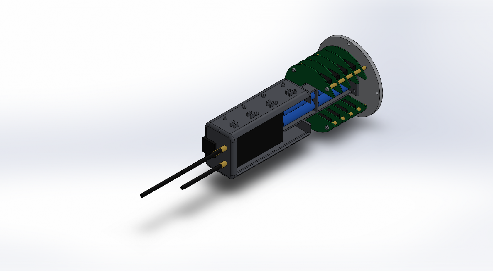
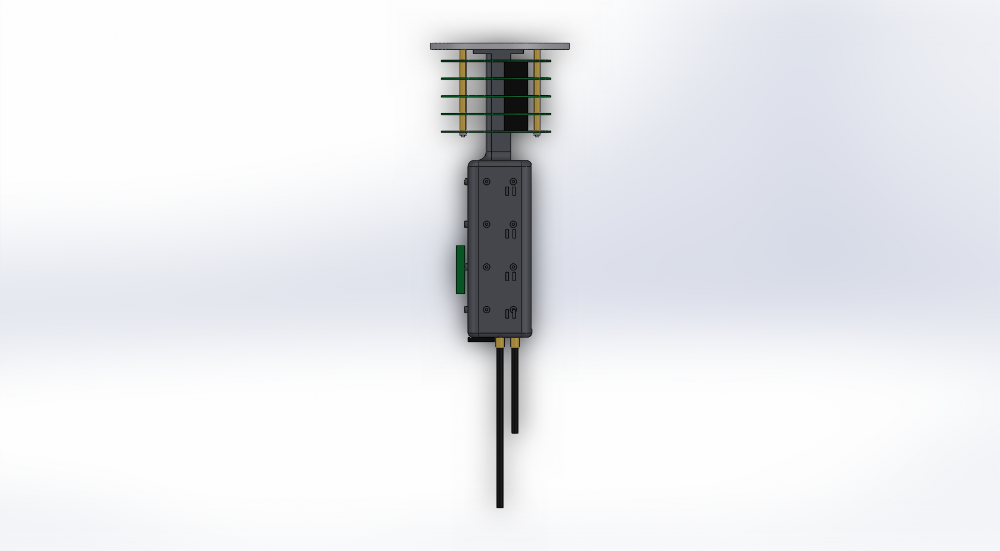
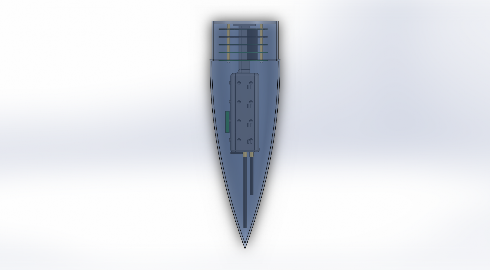

# CAD 來源

狀態：概念模型 avbay v0.7，尚未經團隊審查，尺寸未定案。

CAD 工具：SOLIDWORKS 2018 SP3。較新版本可開啟，但存檔後舊版無法再開，升級前先討論。

## 構型

- 艙壁板位於鼻錐肩部內，承載整組航電艙。
- 馬蹄形電路板套在四支 M3 貫穿螺桿上，層與層之間用間隔柱隔開，頂端以螺帽壓緊。電路板不鎖在列印件上。
- 3D 列印的中央脊柱立在艙壁板上，位於電路板的開槽內。下段是朝 +X 開口的電池槽，放四顆 18650，從開口側取放。
- 板堆疊上方，脊柱以圓角過渡擴成一段等截面的中空設備艙。台灣盃公版 GPS 追蹤器（Rocket Beacon）直立放在艙內，由 +X 面的開口取放。
- 設備艙的 −X、+Y、−Y 三個外側面是安裝面：有 M3 自攻螺絲凸台（小模組用）與束線柱（走線用）。自製 GPS 板鎖在 −X 面。
- 設備艙頂端是可拆的列印頂蓋，以兩顆螺絲鎖在 ±Y 牆頂；三支軟質天線與自製 GPS 貼片裝在頂蓋上。

這些做法參考 USCRPL HAMSTER 實物：方柱外側面裝模組、獨立頂蓋裝天線、軟質天線、線材沿柱身用夾子固定。

版本沿革：v0.1 至 v0.6 皆未被採用，檔案已移除（v0.4 曾提交，見 git 歷史）。v0.7 在 v0.6 的單段設備艙上加入外側安裝面、束線柱、可拆頂蓋，並把硬鋼絲天線改為軟質天線。

## 組立入口

- 航電艙本體：`avbay_v0_7_assembly.SLDASM`。座標原點在艙壁板底面中心（即鼻錐開口端面），+Z 指向鼻錐尖端，+X 是脊柱與電路板的開口側。
- 裝入鼻錐的檢查：`fitcheck_avbay_v0_7_assembly_in_NOSE_v1.SLDASM`，由 `fitcheck_nose.py` 產生，鼻錐設為半透明。







## 檔案

| 檔案 | 內容 | 站位 z（mm） |
| --- | --- | --- |
| `NOSE_v1.SLDPRT` | 鼻錐（團隊提供）：總長 480，錐體外徑 148、壁厚 4，肩部外徑 140、內徑 132、長 80 | 建模方向為 +X，尖端在 x = 0 |
| `avbay_v0_7_bulkhead.SLDPRT` | 艙壁板，直徑 130、厚 6 | 0 至 6 |
| `avbay_v0_7_spine.SLDPRT` | 中央脊柱：底座、電池槽、兩片電池隔板、設備艙（無頂）、凸台、束線柱 | 6 至 272 |
| `avbay_v0_7_cap.SLDPRT` | 設備艙頂蓋：3 高的內嵌唇加 4 厚的蓋板，含天線孔與螺絲孔 | 269 至 276 |
| `avbay_v0_7_pcb_outline.SLDPRT` | 馬蹄形 PCB 外形，直徑 110、厚 1.6，共用 5 次 | 16、32.6、49.2、65.8、82.4 起 |
| `avbay_v0_7_rod_m3.SLDPRT` | M3 螺桿，長 88，4 支 | 0 至 88 |
| `avbay_v0_7_spacer_m3_10.SLDPRT` | 間隔柱，長 10，4 支 | 6 至 16 |
| `avbay_v0_7_spacer_m3_15.SLDPRT` | 間隔柱，長 15，16 支 | 各層板之間 |
| `avbay_v0_7_nut_m3.SLDPRT` | 螺帽佔位，4 個 | 84 至 86.4 |
| `avbay_v0_7_stack_connector.SLDPRT` | 板對板接頭佔位，22 × 7 × 15，8 個 | 各層板之間 |
| `avbay_v0_7_cell_18650.SLDPRT` | 18650 電池佔位，直徑 18.5、長 65，4 顆 | 12 至 77、85 至 150 |
| `avbay_v0_7_tracker.SLDPRT` | 公版 GPS 追蹤器佔位，32 × 65 × 110（估計值） | 158 至 268 |
| `avbay_v0_7_gps_board.SLDPRT` | 自製 GPS 板佔位，8 × 30 × 45，立於 −X 面凸台上 | 190 至 235 |
| `avbay_v0_7_sma_base.SLDPRT` | SMA 座佔位，直徑 8、高 10，3 個 | 276 至 286 |
| `avbay_v0_7_ant_433.SLDPRT` | 433 MHz 軟質天線佔位，直徑 6、長 150 | 286 至 436 |
| `avbay_v0_7_ant_920.SLDPRT` | 920 MHz 軟質天線佔位，直徑 6、長 80 | 286 至 366 |
| `avbay_v0_7_ant_tracker.SLDPRT` | 追蹤器自帶 LoRa 軟質天線佔位，直徑 6、長 80 | 286 至 366 |
| `avbay_v0_7_gnss_patch.SLDPRT` | 自製 GPS 陶瓷貼片天線佔位，25 × 25 × 4 | 276 至 280 |
| `avbay_v0_7_assembly.SLDASM` | 組合件，57 個元件，全部固定、未加結合條件 | — |
| `build_avbay.py` | 產生以上 avbay 檔案與三張預覽圖的參數化腳本 | — |
| `fitcheck_nose.py` | 把航電艙放進鼻錐、跑干涉檢查並輸出間隙報告與兩張圖 | — |

PCB 由底部往尖端的預定用途：1 備援、2 電源、3 主系統、4 預留、5 通訊。電池下層一對預定給備援，上層一對給主系統。此分配尚未寫入決策紀錄，對應的板版號尚未建立。

## 公版 GPS 追蹤器（Rocket Beacon）

依「附件十八：3K組公版GPS追蹤器技術資料」（Ver1，2025-10-30）：它是一個灌膠防水的盒子，內含 18650 電池、Meshtastic LoRa 無線電（Region 設 TW）、GPS 模組，側面出 SMA 天線接頭，另有 XT30 啟動 key 與充電線，盒底四角有安裝耳。文件沒有尺寸；模型中的 32 × 65 × 110 是從圖片估計的，安裝耳未建模，取得實物後必須更正。

安裝建議（文件第 9 頁）：GPS 朝上或朝外、天線垂直於地面為佳。目前的放法是直立於艙內、GPS 朝向開口側、天線垂直向上，屬於文件列出的可接受方向。

## 關鍵尺寸

電路板與固定：

- PCB 開槽：寬 47（Y 方向 ±23.5），自 x = −14 開到 +X 板邊，槽底兩角 R6，兩個馬蹄尖端 R3；開槽後板面積約剩 68%。
- 螺桿孔：4 個 M3 孔（孔徑 3.2）位於節圓 98，角度 45°、135°、225°、315°。
- 層距 16.6（15 的間隔柱加板厚 1.6）。
- 板對板接頭佔位中心在 (15, ±36)，即開口側的兩臂上，僅表示預留空間，實際型號與位置未定。

脊柱：

- 電池槽段（z 6 至 110 外露，槽壁在艙內延續到 z 156）：X 方向 −13 至 +10、Y 方向 ±22.5，壁厚 3，背面兩角 R5；槽內寬 39、深 20。
- 底座：47 × 45、厚 4，以 4 顆 M4 鎖在艙壁板，孔位 (−19, ±15) 與 (16, ±15)。
- 設備艙（z 110 至 272 為牆，頂蓋到 276）：60 × 80 等截面，垂直角 R10，壁厚 4，內部淨空 52 × 72，底面距最上層板頂面 26。+X 面有一個開口（寬 68，z 114 至 268），下段用來取放上層電池，上段用來取放追蹤器。
- 圓角過渡：電池槽段接設備艙底面 R8；設備艙底緣 R6；頂蓋頂緣 R5。
- 安裝凸台：直徑 6、高 3，孔徑 2.5（M3 自攻）。±Y 面各 8 個，x = ±12.5、z = 130、170、210、250；−X 面 8 個，y = ±15、同樣四個站位。
- 束線柱：每組兩根 2.5 × 8 的柱子，間隙 4，外伸 6；±Y 面各 4 組，x = 10，z = 135、175、215、250。
- 頂蓋：唇 52 × 72 減單邊 0.3 間隙、高 3；蓋板 60 × 80、厚 4；螺絲孔直徑 2.7 位於 (0, ±38)，牆頂對應直徑 2.3、深 8 的導孔；天線孔直徑 6.5。

天線（頂蓋頂面，z 276，座標為該面上的 x、y）：

- 433 MHz 軟質：(0, 0)，軸線上垂直向上，長 150，尖端到 z 436。
- 920 MHz 軟質：(14, −14)，垂直向上，尖端到 z 366。
- 追蹤器 LoRa 軟質：(14, +14)，垂直向上，尖端到 z 366。
- 自製 GPS 貼片：(−17.5, 0)，朝上。

艙壁板開孔：4 個 M3 螺桿孔、4 個 M4 固定孔（節圓 118、0° 起，鎖進鼻錐內的列印環）、4 個 M4 脊柱底座孔、2 個 M6 U 型螺栓孔位於 (0, ±30)、1 個直徑 10 的走線孔位於 (−40, 0)。

## 重新產生

需要 Windows、已啟動且沒有開啟任何文件的 SOLIDWORKS、Python 3.10 以上與 pywin32。

```bash
python mechanical/cad/build_avbay.py
```

```bash
python mechanical/cad/fitcheck_nose.py
```

尺寸集中在 `build_avbay.py` 開頭的 PARAMS。腳本會覆寫本目錄中同名的 avbay_v0_7 與 fitcheck 檔案；手動修改過的模型請另存新版號。`NOSE_v1.SLDPRT` 只被讀取，不會被改寫。

## 已知限制與驗證狀態

- 已執行（avbay 組合件）：SOLIDWORKS 干涉檢查 0 處（重合面不計）。
- 已執行（裝入 NOSE_v1）：SOLIDWORKS 干涉檢查 0 處。對鼻錐內壁的徑向間隙（取樣每 5 mm 取最小半徑，為保守值）：艙壁板 1.0、最上層板 11.0、設備艙底角 23.2、設備艙頂角 5.3、433 天線尖端 5.6、920 與追蹤器天線尖端 7.9、最上排束線柱 6.3、自製 GPS 板外緣 13.7。433 天線尖端到內側尖端約 29。
- 已讀回：脊柱為單一實體，體積約 179 cm³（以實心 PETG 估算約 230 g，實際重量取決於列印填充率）。
- 追蹤器尺寸是估計值；安裝耳若存在且外伸，艙內 72 的淨寬放不下，需改用其他固定方式或加大設備艙並降低頂面。
- 433 MHz 天線長 150 是受鼻錐尖端空間限制，比 1/4 波長（約 165）短，需選用免接地面的軟質短天線並以 SWR 量測確認；兩支鞭狀天線都裝在列印件上，沒有接地面。
- 920 MHz 主遙測與追蹤器的 Meshtastic（TW 頻段，約 923 MHz）在同一頻段，兩支天線相距 28，發射時會互相壓制，需要實測並協調頻道與發射時序。
- 凸台與束線柱的位置是示意，依實際模組與線束調整；凸台孔徑 2.5 適用 M3 自攻螺絲，若改用熱熔螺母要加大。
- 鼻錐內輪廓是從 `NOSE_v1.SLDPRT` 的網格取樣，`build_avbay.py` 內的 `nose_profile` 只是這份取樣的複本，鼻錐改版時要重新取樣。
- 尚未執行：強度、振動、熱、列印與製造可行性、實體試裝、天線 SWR 與相互干擾量測。
- 尚未建模：追蹤器在艙內的固定方式、天線同軸線的走線路徑、電池接點與固定方式、電池槽蓋、主備電池之間的防火隔離、鼻錐內的列印固定環、螺桿在艙壁板側的固定方式、解鎖開關、狀態燈、XT30 啟動 key 引出座與對外開孔。
- 設備艙底面是懸空面，+X 面開口後兩側只剩寬 6 的立柱；列印方向、是否需要支撐材或拆件、以及開口對剛性的影響尚未評估。
- 螺帽上方約 24 的空間供扳手與走線使用，實際是否足夠需要試裝確認。
- 電池只是圓柱佔位，顆數與串並聯方式未定案。下層電池位於板堆疊的開槽內，取放是否順手需要試裝確認。

需要交換 STEP／STL 時，再建立 exports/ 並記錄來源版本。關鍵尺寸與裝配介面集中到 docs/interfaces.md。模型存在不代表完成干涉、強度或製造驗證。
